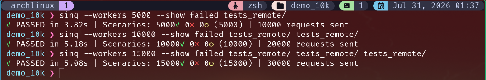

# Introduction to sinq

**sinq** tests your API. It runs sequences of HTTP requests as workflows (log in, create, poll, check) and verifies every response along the way. Each workflow is a folder of request files, and independent workflows run in parallel.

---

## Why sinq?

Most API testing tools treat a test as a set of independent requests. `sinq` treats it as a workflow whose requests pass state from one to the next, the way a real session does.

The workflow is your directory layout. A folder is a flow and its files are the steps, in natural-sorted order. Shared setup, like authentication, goes in a parent folder and everything beneath it inherits it. Each leaf folder is one scenario with its own Lua state and cookie jar, so scenarios share nothing and run concurrently, limited by the worker count.

A `.sinq` file is a plain HTTP request with Lua wherever you need logic. Nothing sits between what you write and what goes on the wire. Four hooks cover the rest of the lifecycle: `$PRE` for setup and file I/O, `$RETRY` for polling, `$ASSERT` for checks, and `$POST` for pulling values out of a response so later requests can use them.

It ships as one static binary or a small container with nothing else to install, and it writes JUnit XML for CI.

---

## License

`sinq` is free and open source software, released under the [GNU General Public License v3](https://github.com/Veitangie/sinq/blob/main/LICENSE.md). You can use it at work, in CI and in commercial projects. If you distribute a modified version of `sinq` itself, the GPLv3 requires you to share that version's source under the same license. Your test files are your own: running `sinq` on them doesn't put them under the GPL.

---

## Next

* **[Getting Started](getting-started.md)**: install and run `sinq`.
* **[CLI Reference](cli.md)**: every flag, the scenario filters, and the environment variables.
* **[Scenarios & Configuration](scenario.md)**: the request lifecycle and `.scenario` files.
* **[Lua API Reference](lua-api.md)**: built-in functions, fake data, encoding, and crypto helpers.
* **[Versioning & Compatibility](versioning.md)**: what the SemVer promise does and does not cover.
